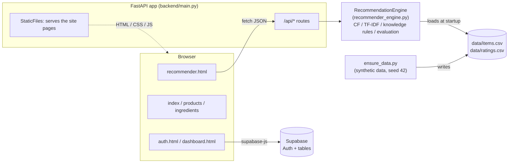

# DearSkin Recommender

DearSkin is a skincare-themed web project with two parts: a static multi-page front end (landing page, product and ingredient catalogues, a user dashboard with Supabase authentication) and a **Python/FastAPI recommender lab** that implements and compares collaborative, content-based and knowledge-based recommendation methods on a synthetic skincare catalogue, with offline ranking evaluation (Precision@K, Recall@K, MAP@K, NDCG@K).

The recommender code describes itself as coursework (`recommender_engine.py`: "Recommendation algorithms + ranking evaluation for coursework"; `recommender.html`: "Course-grade pipeline"). It was built as a recommender-systems course project.

## Problem statement

Choosing skincare products depends on personal taste, budget and preferences such as brand, category or fragrance-free formulas. The project explores how different recommender paradigms rank products for the same shopper, explains each recommendation in plain language, and measures how well each method recovers held-out liked items.

## Key features

**Recommender lab (`recommender.html` + FastAPI backend)**

- **Collaborative filtering, four variants**
  - User-based kNN with cosine similarity (`user_cosine`)
  - User-based kNN with Pearson correlation (`user_pearson`)
  - Item-based kNN with cosine similarity (`item_cosine`)
  - Matrix factorisation via truncated SVD (`mf_svd`, `scipy.sparse.linalg.svds`, up to 12 latent factors, missing ratings filled with the global mean)
  - Neighbourhoods are capped at 35 positive-similarity neighbours; items that cannot be predicted fall back to the item's mean rating.
- **Content-based filtering**: TF-IDF vectors (scikit-learn, max 120 features) over each item's category, brand and tags; a user profile is the rating-weighted average of rated items' vectors, scored against items by cosine similarity.
- **Knowledge-based ranking**: explicit constraints (max budget, preferred categories, preferred brands, fragrance-free preference) apply multiplicative boosts/penalties, combined with item-based CF affinity.
- **Explanations**: every recommendation carries a text explanation (e.g. closest neighbour and similarity, similar rated items, which constraints were met).
- **Side-by-side comparison**: approach `all` returns the collaborative, content and knowledge lists as separate panels; the UI shows the Jaccard overlap between the three lists. There is no single fused hybrid score.
- **Session rating updates**: `POST /api/ratings` updates the in-memory rating matrix.
- **Offline evaluation**: per-user hold-out (default 22% of rated items, seed 7), relevance = held-out rating >= 4.0, K = 10. Reports Precision@K, Recall@K, MAP@K and NDCG@K for all six methods plus an auto-generated comparison summary. The UI renders a results table and a Chart.js bar chart of MAP@K.

**Static site pages**

- `index.html`: landing page with an onboarding form, ingredient and product highlights, and dashboard-style widgets (routine, skin profile, compatibility checker, skincare assistant). These widgets are static HTML mock-ups with no backend logic.
- `products.html`: product grid with category filter and quick-view modal (hard-coded product data).
- `ingredients.html`: ingredient library with detail views (hard-coded ingredient data).
- `auth.html`: email/password sign-up and login through Supabase Auth; on sign-up a row is inserted into a `profiles` table.
- `dashboard.html`: requires a Supabase session; reads the user's `profiles` row for the greeting and writes to the `routine` and `saved_products` tables from its buttons. Other dashboard content (journal, progress, calendar, past purchases, hormonal phase) is static or placeholder data.
- `widgets.html`: redirects to `recommender.html`.

## Tech stack

| Layer | Technology |
|---|---|
| Front end | HTML, CSS (`styles.css`), vanilla JavaScript |
| Front-end libraries (CDN) | Chart.js 4.4.1 (recommender lab), Lucide icons, Google Fonts, `@supabase/supabase-js` 2.49.1 via esm.sh |
| Auth / user data | Supabase (Auth + tables `profiles`, `routine`, `saved_products`) |
| Backend API | FastAPI, Uvicorn, Pydantic |
| Recommender / evaluation | NumPy, pandas, SciPy, scikit-learn |
| Data | Synthetic CSV files generated by `ensure_data.py` |

## Architecture



On startup, `main.py` calls `ensure_data_dir()` (which regenerates the CSVs) and loads the engine. The same FastAPI app mounts the project folder as static files, so the pages and the API share one origin.

## Project structure

All application code lives in a nested folder, `Downloads/dear-skin-main/dear-skin-main/dear-skin-main/`. Paths below are relative to that folder.

```
Downloads/dear-skin-main/dear-skin-main/dear-skin-main/
├── index.html                 # Landing page
├── products.html              # Product catalogue (static data)
├── ingredients.html           # Ingredient library (static data)
├── recommender.html           # Recommender lab UI (calls the FastAPI backend)
├── widgets.html               # Redirect to recommender.html
├── auth.html                  # Supabase sign-up / login
├── dashboard.html             # Supabase-protected dashboard
├── script.js                  # Shared UI helpers (icons, mobile menu, scrolling)
├── styles.css                 # Shared styles
├── supabase.example.js        # Template for supabase.js (git-ignored)
├── README.md                  # Older nested README
└── backend/
    ├── main.py                # FastAPI app: API routes + static file serving
    ├── recommender_engine.py  # Algorithms, explanations, evaluation metrics
    ├── ensure_data.py         # Synthetic data generator
    ├── requirements.txt
    └── data/
        ├── items.csv          # 72 synthetic products
        └── ratings.csv        # Synthetic ratings from 60 users
```

## Getting started

### Prerequisites

- Python 3.9 or newer
- Git
- Optional: a Supabase project, needed only for `auth.html` and `dashboard.html`

### Installation

```bash
git clone https://github.com/Rewanooo22/dear-skin-recommender.git
cd dear-skin-recommender/Downloads/dear-skin-main/dear-skin-main/dear-skin-main/backend

python -m venv .venv
source .venv/bin/activate        # Windows: .venv\Scripts\activate
pip install -r requirements.txt
```

### Running

```bash
# from .../dear-skin-main/backend
python ensure_data.py            # optional: the server also regenerates data/ on startup
uvicorn main:app --reload --port 8000
```

Then open:

- `http://127.0.0.1:8000/` (landing page)
- `http://127.0.0.1:8000/recommender.html` (recommender lab; leave "API base URL" empty when served this way)
- `http://127.0.0.1:8000/docs` (FastAPI's interactive API docs)

If you serve the pages from a different static server, enter `http://127.0.0.1:8000` in the lab's "API base URL" field. CORS is open to all origins.

### Supabase setup (optional)

The auth-related pages import `supabase.js`, which is git-ignored and not committed. Create it from the template:

```bash
cd Downloads/dear-skin-main/dear-skin-main/dear-skin-main
cp supabase.example.js supabase.js
```

Then edit the two constants in `supabase.js`:

| Constant | Purpose |
|---|---|
| `SUPABASE_URL` | Your Supabase project URL |
| `SUPABASE_ANON_KEY` | Your project's public anon key |

These are JavaScript constants, not environment variables. No SQL schema or migration is included in the repository. You need to create the `profiles`, `routine` and `saved_products` tables yourself, with the columns the pages use (`profiles`: `id`, `email`, `name`, `created_at`; `routine`: `user_id`, `step`, `product_id`; `saved_products`: `user_id`, `product_id`).

## API reference

| Method | Path | Description |
|---|---|---|
| GET | `/api/health` | Service status and whether the engine is loaded |
| GET | `/api/meta` | User/item counts, CF methods, approaches, categories, brands, metric names |
| GET | `/api/catalog` | All catalogue items |
| GET | `/api/users/{user_id}/profile` | A synthetic user's rating history |
| POST | `/api/ratings` | Set a rating in the in-memory matrix. Body: `user_id`, `item_id`, `rating` (1.0–5.0) |
| POST | `/api/recommendations` | Recommendations with explanations (body fields below) |
| GET | `/api/evaluation` | Offline evaluation. Query: `holdout_ratio` (default 0.22), `max_users` (optional; all users if omitted) |

`POST /api/recommendations` body:

| Field | Type | Default | Notes |
|---|---|---|---|
| `user_id` | int | required | Synthetic user id (0 to n_users - 1) |
| `approach` | string | required | `collaborative`, `content`, `knowledge` or `all` |
| `cf_method` | string | `user_cosine` | `user_cosine`, `user_pearson`, `item_cosine` or `mf_svd` |
| `top_k` | int | 8 | 1–40 |
| `max_budget` | float or null | null | Knowledge-based constraint |
| `categories` | list of strings | `[]` | `Serum`, `Cleanser`, `Moisturizer`, `Sunscreen`, `Treatment` |
| `brands` | list of strings | `[]` | `DearGlow`, `PureLab`, `SkinTheory`, `AquaVeil`, `BareEssence` |
| `prefer_fragrance_free` | bool | false | Boosts items tagged `fragrance-free` |

### Examples

```bash
curl -X POST http://127.0.0.1:8000/api/recommendations \
  -H "Content-Type: application/json" \
  -d '{"user_id": 3, "approach": "knowledge", "top_k": 5, "max_budget": 50, "categories": ["Serum"], "prefer_fragrance_free": true}'
```

```bash
curl "http://127.0.0.1:8000/api/evaluation?max_users=35"
```

## Data

`backend/ensure_data.py` generates **synthetic** data with a fixed NumPy seed (`default_rng(42)`):

- 72 items across 5 categories and 5 fictional brands, priced between $12 and $95, each with 6 tags from a fixed tag pool.
- 60 users, each rating 35–55 items. Ratings come from latent user/item factor dot products plus Gaussian noise, clipped to 1–5.

No real product, review or ingredient dataset is used.

## Results

No evaluation results are committed to the repository. Run `GET /api/evaluation` (or the "Evaluation & comparison" section of the lab) to compute metrics. Because the data is synthetic, the numbers describe this generated dataset only.

## Project status and limitations

- Coursework prototype; there are no automated tests or CI.
- The recommender runs on synthetic data only.
- The server regenerates `data/*.csv` on every startup, and ratings posted to `/api/ratings` live in memory and are lost on restart.
- Evaluation is computed on request and can be slow (the lab UI notes roughly 30–90 s for 35 users).
- The landing page, product and ingredient catalogues and most dashboard widgets use hard-coded content; the compatibility checker and skincare assistant are UI mock-ups only.
- `dashboard.html` links to `onboarding.html`, which does not exist in the repository.
- The Supabase table schema is not included.
- The app sits inside a deeply nested `Downloads/...` folder, and `backend/__pycache__/` files are committed.

## Future improvements (ideas)

- Move the app to the repository root and remove the committed `__pycache__` files.
- Add a Supabase SQL schema/migration for the tables the pages use.
- Add a true hybrid model that fuses CF, content and knowledge scores.
- Persist rating updates instead of keeping them in memory.
- Add unit tests for the metrics and algorithms.
- Connect the static catalogue pages to the recommender API.
